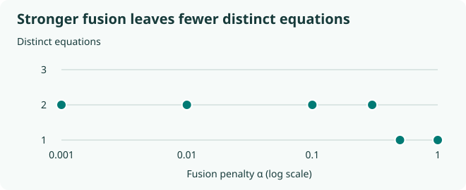

# Category fusion

These estimators are available starting in Structured Linear 0.2.0.

Use category fusion when some unordered groups might follow the same
equation. For example, you might start with one equation per loan purpose and
let the model give similar purposes the same intercept **and** slopes. Unlike
a fused scorecard, any pair of categories can merge, not just neighbors.

See [how scores become predictions](estimators.md#from-model-score-to-prediction)
for the shared regression and classification formulas.

## How the model decides what to merge

The penalty measures how far apart the equations are by comparing their
intercepts and slopes. A stronger penalty favors fewer distinct equations.

For segment vectors $b_g$, augmented predictor rows $z_i=(1,x_i)$, and
normalized sample weights $w_i$, the objective is

$$
\sum_i w_i\,\ell(y_i,z_i^\top b_{g_i})
+ \alpha\sum_{g<h}\lVert b_g-b_h\rVert_2.
$$

`CategoryFusionRegressor` uses half squared error.
`CategoryFusionClassifier` uses binary logistic loss.
The fusion penalty includes the intercept. Put numeric predictors on
comparable scales before fitting if their coefficients should contribute
similarly to the penalty.

```python
import numpy as np
from structured_linear import CategoryFusionRegressor

X = np.array([
    [-1, "north"], [1, "north"],
    [-1, "west"], [1, "west"],
    [-1, "south"], [1, "south"],
], dtype=object)
y = [-1, 1, -1, 1, 4, 2]

model = CategoryFusionRegressor(segment_feature=-1, alpha=0.01).fit(X, y)
print(dict(zip(model.segments_, model.cluster_labels_)))
print(model.predict([[0.5, "north"]]))
```

For a known segment $g$, the prediction score is
$\eta(x,g)=b_{g,0}+\sum_j x_j b_{g,j}$: use that segment’s intercept
and slopes. `segments_` gives the order of rows in `coef_` and entries
in `intercept_`.
`cluster_labels_` reports connected components of pairs within
`fusion_tol` in coefficient distance. Predictions use the fitted
coefficients at solver precision. Prediction requires a segment seen
during fitting. For a shared fallback for unseen segments, see
[data-shared lasso](data-shared.md). The complete-graph penalty has quadratically many pairs
in the number of levels, so start with modest cardinality.

## Inspect the fitted equations

```python
rows = model.effect_table()
print(rows[0])  # Intercept and learned cluster ID for the first segment.
parts = model.predict_contributions(X)
np.testing.assert_allclose(parts.sum(axis=1), model.predict(X))
```

The table contains one row per segment and term, with the learned cluster
ID and coefficient. The intercept row has `feature=None`. Feature names
come from the fitted DataFrame when available, otherwise the table uses
zero-based input-column indices.

See the [prediction breakdown guide](estimators.md#explain-individual-predictions)
for the contribution column order and a classifier example.

This uses equal penalty weights for all category pairs for one categorical
predictor, with optional observation weights. The solver uses primal-dual
splitting. Method reference [Song, Zheng, Li and Xue (2025),
*Collapsing Categories for Regression with Mixed Predictors*](https://arxiv.org/abs/2511.06542).

## Fit a regularization path

Continue the regression example with an explicit grid of penalty strengths.

```python
for point in model.fit_path(X, y, alphas=[0.001, 0.01, 0.1, 0.3, 0.5, 1.0]):
    groups = dict(zip(point.segments_, point.cluster_labels_))
    print(point.alpha, point.converged_, point.n_clusters_, groups)
```



*At the tested penalties, north and west share an equation from the start.
South joins them at `alpha=0.5`. The dots show independent fits, not the exact
point at which the groups merge.*

Each point is a fresh estimator fitted independently with the same settings
and optional sample weights. The returned list follows the supplied order.
Cluster IDs are local to each fit. Compare the sets of segments assigned
to each group rather than comparing the numeric IDs across fits.

See the [German Credit comparison](benchmark.md#category-fusion-on-german-credit)
for a path evaluated with cross-validation.

## Array API inputs

Numeric Array API inputs use the native namespace for solver iterations,
fitted coefficients, predictions, and contribution arrays. Regression and
classification are tested with strict arrays on CPU and simulated non-CPU
devices in float32 and float64. Category labels, row-selection metadata,
and the final cluster graph use CPU processing. The fitted cluster labels
are returned to the input device. See the [hardware support table](estimators.md#pytorch-hardware-verification)
for verified CUDA and Apple MPS configurations.
