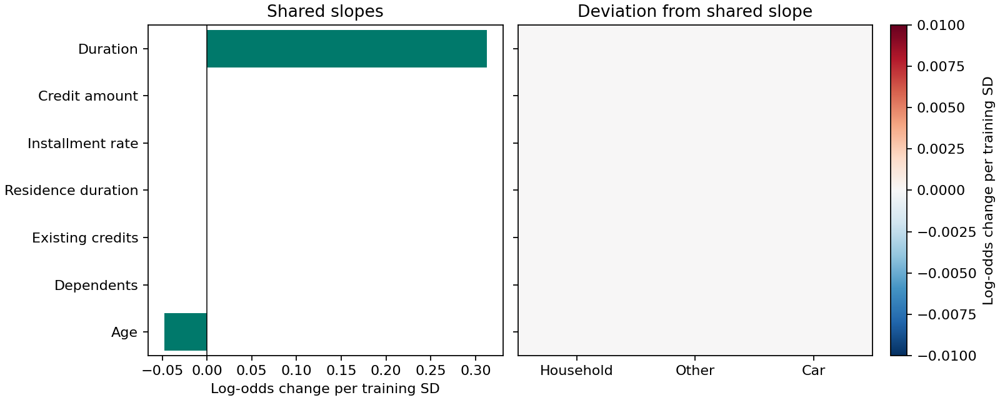

# When do segments need different slopes?

This demo asks whether loan-purpose groups benefit from their own slopes on
[German Credit](https://doi.org/10.24432/C5NC77). It uses seven numeric
predictors and groups the 1,000 applications into car purchases, household
purchases, and other purposes. The target is the dataset's bad-credit label.

## Fit three models on the same splits

1. **Pooled logistic regression** uses one set of slopes and loan-purpose
   indicators to adjust baseline log odds.
2. **Separate logistic regressions** fit their own slopes and intercept in each
   segment.
3. **Data-shared lasso** starts with shared slopes and learns penalized
   segment-specific deviations. It also receives the same loan-purpose
   indicators as the pooled model.

The logistic baselines use ridge penalties. Each approach tunes its own
penalty by inner three-fold cross-validation. A common penalty strength is
selected for the separate fits using their combined validation predictions.
The outer five folds are stratified by segment and label. Numeric predictors
are standardized within each training split, and segment codes pass through
unchanged.

## Held-out performance

Log loss is computed from out-of-fold probabilities. AUC is averaged over the
five outer folds. The segment counts shown are the full out-of-fold counts.

| Model | Log loss | AUC | Car (337) | Household (495) | Other (168) |
| --- | ---: | ---: | ---: | ---: | ---: |
| Pooled + segment indicators | **0.5838** | **0.6425** | **0.6052** | 0.5591 | **0.6134** |
| Separate per segment | 0.5859 | 0.6385 | 0.6068 | 0.5606 | 0.6184 |
| Data-shared lasso | 0.5870 | 0.6351 | 0.6090 | **0.5584** | 0.6273 |

The last three columns show log loss by segment. Pooling performed best
overall and in the smallest segment. Data-shared lasso's lead in the household
segment was only 0.0007 in log loss. These are descriptive differences from
one dataset and one set of splits.

## Read the fitted coefficients

The left panel shows `shared_coef_` for the numeric predictors. The right
panel shows each segment's adjustment from `segment_deviations_`. Add the
corresponding bar and cell to get that segment's slope. A white cell near
zero means the segment uses approximately the shared slope. The axes are
on the standardized scale, so a coefficient is a change in log odds per
one training standard deviation. Segment indicator coefficients are omitted.



The plot comes from a separate full-data refit at `alpha=0.03` selected by
cross-validation. The table comes from the outer held-out folds.

## Reproduce the demo

From the [repository root](https://github.com/lcrmorin/structured-linear), run

```bash
python -m pip install structured-linear matplotlib
python benchmarks/demo_data_shared.py --output data-shared-effects.png
```

The script downloads the UCI archive. For an offline run, pass
`--german-credit-archive /path/to/archive.zip`.

Dataset attribution [Hans Hofmann, Statlog (German Credit Data), UCI Machine Learning Repository](https://doi.org/10.24432/C5NC77), CC BY 4.0.
