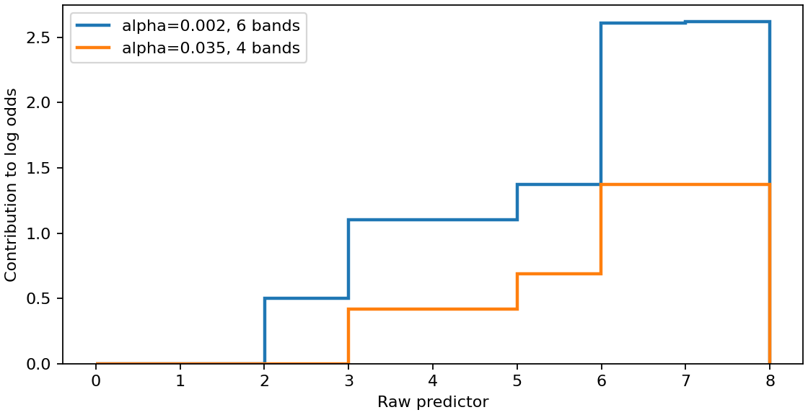

# From raw measurements to a fused scorecard

This example generates a binary outcome whose probability rises in two steps
as a numeric predictor increases. Binning first gives the model eight candidate
bands. The fusion penalty lets adjacent bands share an effect.

## Fit the bins on training data

```python
import matplotlib.pyplot as plt
import numpy as np
from sklearn.metrics import log_loss
from sklearn.model_selection import train_test_split
from sklearn.preprocessing import KBinsDiscretizer

from structured_linear import FusedScorecardClassifier

rng = np.random.default_rng(42)
X = rng.uniform(0, 8, size=(2000, 1))
probability = np.select([X[:, 0] < 3, X[:, 0] < 6], [0.15, 0.40], default=0.75)
y = rng.binomial(1, probability)
X_train, X_test, y_train, y_test = train_test_split(
    X, y, test_size=0.25, stratify=y, random_state=42
)

binner = KBinsDiscretizer(n_bins=8, encode="ordinal", strategy="uniform")
train_bins = binner.fit_transform(X_train)
test_bins = binner.transform(X_test)
bin_order = [range(n) for n in binner.n_bins_]
```

## Compare two penalties

```python
edges = binner.bin_edges_[0]
fig, ax = plt.subplots(figsize=(7, 3.6), layout="constrained")
for alpha in (0.002, 0.035):
    model = FusedScorecardClassifier(alpha=alpha, bin_order=bin_order)
    model.fit(train_bins, y_train)
    rows = model.score_table()
    bands = len({row["merged_bin"] for row in rows})
    loss = log_loss(y_test, model.predict_proba(test_bins))
    print(f"alpha={alpha:g}  bands={bands}  held-out log loss={loss:.4f}")
    print([row["merged_bin"] for row in rows])
    ax.stairs([row["log_odds"] for row in rows], edges,
              label=f"alpha={alpha:g}, {bands} bands", linewidth=2)
ax.set(xlabel="Raw predictor", ylabel="Contribution to log odds")
ax.legend()
plt.show()
```



On this split, the stronger penalty reduced the scorecard from six bands
to four and increased held-out log loss from 0.5205 to 0.5626.

Each repeated `merged_bin` ID groups adjacent input bins into one band.
The vertical axis shows each bin's contribution relative to the first bin.
The values of `alpha` were chosen to illustrate the effect of fusion. For
model selection, tune the penalty on training folds before scoring the test set.

## Handle a bin missing from training

Passing the binner's full `bin_order` allows prediction on a code that the
binner can produce but that happened to be absent from the training sample.
The estimated effect of an empty bin is determined indirectly by the
penalized fit and can be nonunique.

```python
empty_middle = FusedScorecardClassifier(bin_order=[[0, 1, 2]])
empty_middle.fit([[0], [0], [2], [2]], [0, 0, 1, 1])
print(empty_middle.predict_proba([[1]]))
```

With inferred bin order, the same training input would recognize only codes
0 and 2 and prediction on code 1 would raise `ValueError`.
