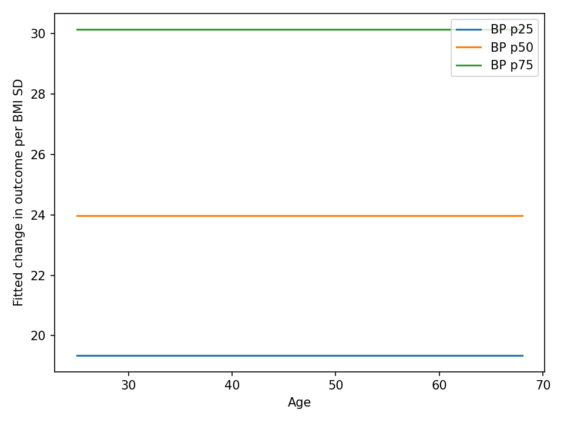

# Conditional slopes and regularization paths

This guide uses scikit-learn's diabetes progression dataset to illustrate
conditional slope estimates and regularization paths with `PliableRegressor`.
For a real binary-classification comparison, see the
[German Credit benchmark](benchmark.md).

## Plot an estimated slope

The diabetes example shows how the fitted BMI slope varies with age at
three blood pressure quantiles. Scale predictors and modifiers before
fitting. For predictive evaluation, fit the scaler only on training data.

```python
import matplotlib.pyplot as plt
import numpy as np
from sklearn.datasets import load_diabetes
from sklearn.preprocessing import StandardScaler

from structured_linear import PliableRegressor

X, y = load_diabetes(as_frame=True, scaled=False, return_X_y=True)
age, bp, bmi = (X.columns.get_loc(name) for name in ("age", "bp", "bmi"))
scaler = StandardScaler().fit(X)
Z = scaler.transform(X)
model = PliableRegressor(alpha=0.75, l1_ratio=0.25, modifier_features=[age, bp])
model.fit(Z, y)
row = np.flatnonzero(model.predictor_indices_ == bmi).item()

age_grid = np.linspace(*X["age"].quantile([0.05, 0.95]), 100)
age_scaled = (age_grid - scaler.mean_[age]) / scaler.scale_[age]
for quantile in (0.25, 0.5, 0.75):
    bp_scaled = np.quantile(Z[:, bp], quantile)
    theta_age, theta_bp = model.interaction_coef_[row]
    slope = model.coef_[bmi] + theta_age * age_scaled + theta_bp * bp_scaled
    plt.plot(age_grid, slope, label=f"BP p{quantile * 100:.0f}")

plt.xlabel("Age")
plt.ylabel("Fitted change in outcome per BMI SD")
plt.legend()
plt.show()
```

For predictor $j$ at modifier values $z$, the conditional slope is

$$
\frac{\partial \eta}{\partial x_j} = \beta_j + z^\top\theta_j.
$$

Use modifier values on the same scale as the inputs to the estimator.
For a classifier, the corresponding slope is in log odds. The fitted
effect depends on the selected penalty, feature scaling, and dataset.



## Trace an interaction path

The path repeatedly fits the same data and changes only `alpha`.
Warm starts reuse the last solution.

```python
from sklearn.base import clone

strengths = np.geomspace(12, 0.1, 24)
path_model = clone(model).set_params(warm_start=True)
bmi_by_age = []

for alpha in strengths:
    path_model.set_params(alpha=alpha).fit(Z, y)
    bmi_by_age.append(path_model.interaction_coef_[row, 0])

plt.figure()
plt.semilogx(strengths, bmi_by_age)
plt.gca().invert_xaxis()
plt.xlabel("Penalty strength")
plt.ylabel("BMI × age coefficient")
plt.show()
```


