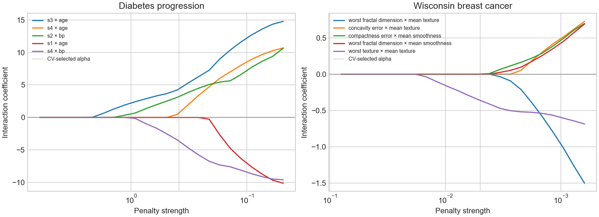

# Conditional slopes and regularization paths

`PliableRegressor` and `PliableClassifier` let a predictor's slope vary with
selected modifier columns. The examples use the scikit-learn diabetes
progression and Wisconsin Diagnostic Breast Cancer datasets. The breast
cancer example encodes malignant as the positive class.

## Plot an estimated slope

The diabetes example shows how the fitted BMI slope varies with age at
three blood pressure quantiles. Scale predictors and modifiers before
fitting. For predictive evaluation, fit the scaler only on training data.

```python
import matplotlib.pyplot as plt
import numpy as np
from sklearn.datasets import load_diabetes
from sklearn.preprocessing import StandardScaler

from pliable_lasso import PliableRegressor

X, y = load_diabetes(as_frame=True, scaled=False, return_X_y=True)
age, bp, bmi = (X.columns.get_loc(name) for name in ("age", "bp", "bmi"))
scaler = StandardScaler().fit(X)
Z = scaler.transform(X)
model = PliableRegressor(alpha=0.75, l1_ratio=0.25, modifier_features=[age, bp])
model.fit(Z, y)
row = np.flatnonzero(model.predictor_indices_ == bmi).item()

age_grid = np.linspace(*X["age"].quantile([0.05, 0.95]), 100)
age_scaled = (age_grid - scaler.mean_[age]) / scaler.scale_[age]
for quantile in (0.25, 0.5, 0.75):
    bp_scaled = np.quantile(Z[:, bp], quantile)
    theta_age, theta_bp = model.interaction_coef_[row]
    slope = model.coef_[bmi] + theta_age * age_scaled + theta_bp * bp_scaled
    plt.plot(age_grid, slope, label=f"BP p{quantile * 100:.0f}")

plt.xlabel("Age")
plt.ylabel("Fitted change in outcome per BMI SD")
plt.legend()
plt.show()
```

For predictor $j$ at modifier values $z$, the conditional slope is

```math
\frac{\partial \eta}{\partial x_j} = \beta_j + z^\top\theta_j.
```

Use modifier values on the same scale as the inputs to the estimator.
For the classifier, this is a slope in log odds. The slope is descriptive and
depends on the selected penalty, scaling and fitted dataset. In the benchmark
fit the BMI slope varies with blood pressure and stays flat across age.
The mean-radius slope is zero at the selected penalty. The interaction
path shows where other coefficients become active.


## Trace an interaction path

The path repeatedly fits the same data and changes only `alpha`. The
vertical line in the benchmark chart marks the full-data CV-selected
penalty. Warm starts reuse the last solution.

```python
from sklearn.base import clone

strengths = np.geomspace(12, 0.1, 24)
path_model = clone(model).set_params(warm_start=True)
bmi_by_age = []

for alpha in strengths:
    path_model.set_params(alpha=alpha).fit(Z, y)
    bmi_by_age.append(path_model.interaction_coef_[row, 0])

plt.figure()
plt.semilogx(strengths, bmi_by_age)
plt.gca().invert_xaxis()
plt.xlabel("Penalty strength")
plt.ylabel("BMI × age coefficient")
plt.show()
```



## Compare with segmentation

The benchmark includes two separate additive elastic-net models split at
the training-fold median age or mean texture. Each segment has its own
intercept and coefficients. A common regularization setting is tuned on
pooled validation predictions.

| Model | Diabetes RMSE | Wisconsin log loss | Wisconsin AUC |
|---|---:|---:|---:|
| Additive elastic net | 55.086 | 0.0862 | 0.9953 |
| Explicit-interaction elastic net | 54.639 | 0.0841 | 0.9954 |
| Segmented elastic net | 54.964 | 0.0918 | 0.9936 |
| Pliable | 54.648 | 0.0887 | 0.9950 |

Scores are local averages over two repetitions of five held-out folds.
The diabetes differences are small relative to fold-to-fold variation.
The Wisconsin SAGA baselines emitted convergence warnings during the
tuning runs. A separate check of the selected settings found warnings in
4 of 10 explicit-interaction refits, so its numerical lead is provisional.
All 48 pliable fits used in the displayed regularization paths converged.
